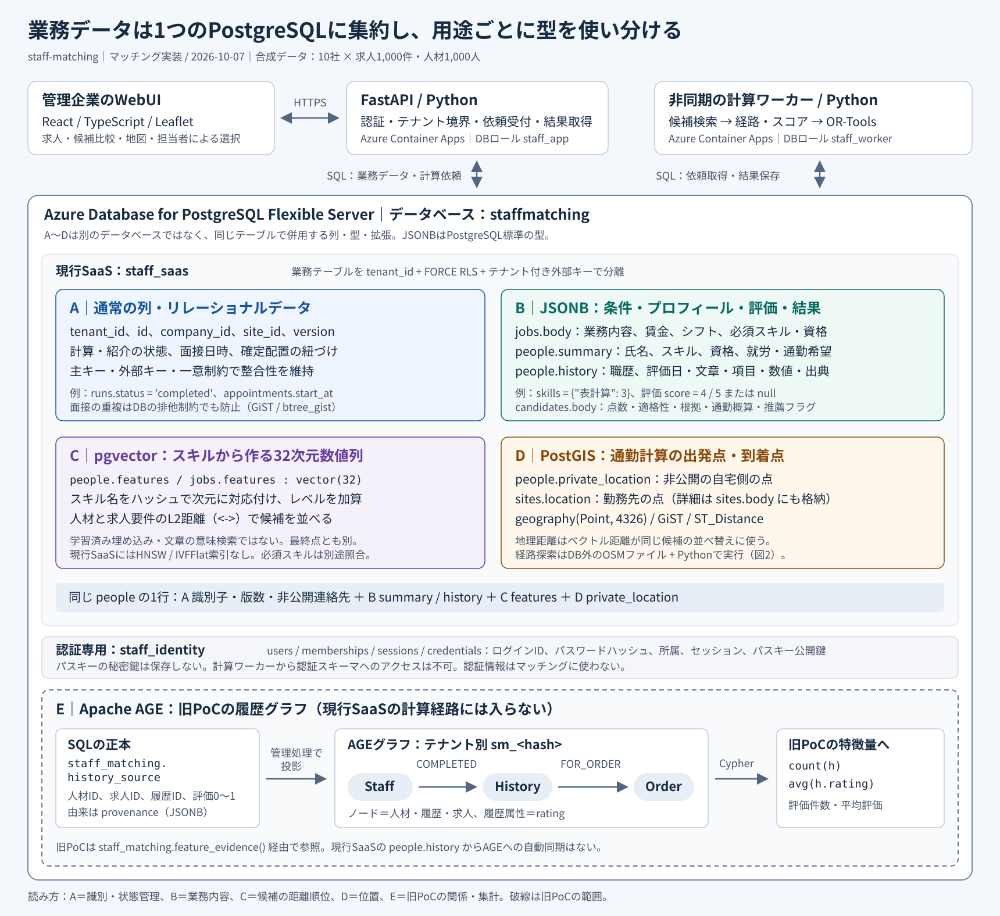
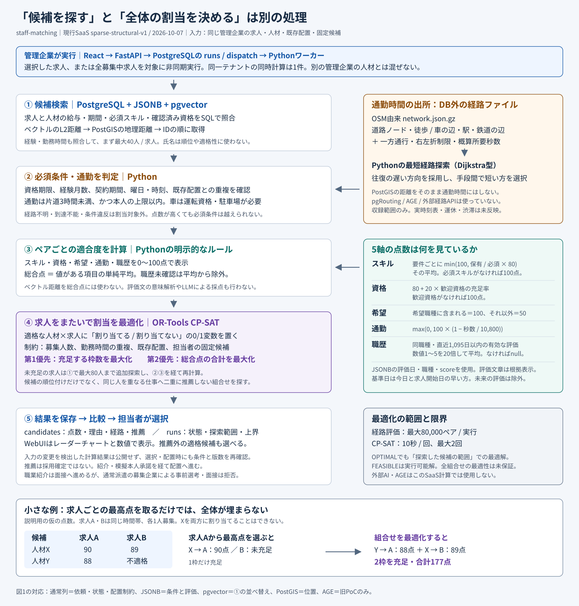

# マッチングは「候補検索」と「制約付き割当最適化」に分かれる

現行SaaSは、PostgreSQLから条件に合う候補を絞り、Pythonで通勤時間と適合度を計算し、**OR-Tools CP-SATで求人間の割当を最適化**します。pgvectorは候補を並べるために使い、最終的な割当を決めるのはCP-SATです。

対象は2026年10月7日時点のマッチング実装と、現行SaaSのモデル `sparse-structural-v1`。将来の構想と、旧PoCに残る実装は区別しています。図中の件数は合成データv2の投入規模です。稼働状態を示す監視図ではありません。

## 図1：通常列・JSONB・ベクトル・地理情報は同じ行に共存する



[図1をSVGで開く](diagrams/matching-data.svg)。SVGは拡大しても文字がぼやけず、ブラウザで表示できます。

「PostgreSQLの通常データ」「JSON」「pgvector」「AGE」は、すべて別々のデータベースという意味ではありません。通常のテーブルの列としてJSONB・vector・geographyを併用し、AGEのグラフも同じPostgreSQL内に置いています。

| 区分 | 保存されるデータと場所 | 現行マッチングでの役割 |
| --- | --- | --- |
| **A 通常の列** | `staff_saas` のテナント・求人・人材・企業・拠点ID、版数、計算・紹介の状態、面接日時、確定配置の関連。型は `text`、`integer`、`boolean`、`timestamptz` など。 | テナント分離、参照整合性、処理状態・募集枠・既存配置の管理。勤務条件や募集人数自体は主に求人のJSONBに入る。 |
| **B JSONB** | 求人は `jobs.body`、人材プロフィールは `people.summary`、職歴は `people.history`、候補結果は `candidates.body`。DB内では文字列としてのJSONではなく、構造を検索できる `jsonb` 型。 | JSONB演算子で資格・スキル・給与・期間を照合。Pythonが残りの条件とスコアを評価する。 |
| **C pgvector** | `jobs.features` と `people.features` に `vector(32)`。スキル名をSHA-256で32次元の位置に対応付け、同じ位置のスキルレベルを足す。 | L2距離演算子 `<->` による候補の並べ替え。文章の意味埋め込みではなく、ベクトル距離は最終点にも加算しない。 |
| **D PostGIS** | `sites.location` と `people.private_location` に `geography(Point, 4326)`。勤務先の点は `sites.body` や求人内の拠点情報にも含まれる。 | 位置の保存と `ST_Distance` による距離計算。候補検索ではベクトル距離が同じときの順位に使う。通勤時間への単純換算には使わない。 |
| **E Apache AGE** | 旧PoCのテナント別グラフ `sm_<tenantのハッシュ>`。ノードは `Staff`、`History`、`Order`。関係は `COMPLETED`、`FOR_ORDER`。履歴に `rating` を持つ。 | **現行SaaSの計算では使用しない。** 旧PoCではCypherで履歴件数と平均評価を集計し、旧計算の特徴量へ渡す。 |

例えば `people` の1行には、通常列の `tenant_id`・`id`・`version`、JSONBの `summary`・`history`、ベクトルの `features`、地理情報の `private_location` が共存します。正確な住所・連絡先も非公開列に保存しますが、公開APIからは除外します。地図には居住エリアの代表点と公開経路だけを表示します。

求人JSONBには仕事内容、職種、時給、募集人数、契約期間、曜日・時間、必要なスキルと資格が入ります。人材JSONBには保有スキル、資格の確認状況と期限、就労可能期間、希望給与、通勤手段と上限などが入ります。職歴JSONBは就業先・職種・期間・業務内容に加え、次のような評価を保持します。これは構造の説明用の抜粋です。

```json
{
  "recorded_at": "2026-09-01",
  "observation": "引継ぎ事項を整理し、担当者が確認しやすい順に報告した。",
  "dimension": "collaboration",
  "score": 4,
  "source": "架空の就業先担当者による振り返り"
}
```

`observation` は人が読む根拠です。採点には有効な日付・職種・数値の `score` を使い、文章から能力を推測する処理は実装していません。`score: null` や古い評価を0点扱いすることもありません。

### AGEの旧PoC履歴とSaaSの職歴は別データ

旧PoCの正本は `staff_matching.history_source` です。管理処理がこれをAGEへ投影し、次の経路を検索します。

```text
(Staff)-[:COMPLETED]->(History {rating: 0〜1})-[:FOR_ORDER]->(Order)
```

`staff_matching.feature_evidence()` が `count(h)` と `avg(h.rating)` を取得し、SQL正本の集計と一致することを確認します。実行時ロールにAGEの直接操作は許可せず、この固定関数を窓口にしています。現行SaaSの `people.history` からこのグラフへの自動同期はありません。

旧PoCは4次元のスキルベクトルとコサイン距離 `<=>` を使います。一方、現行SaaSは32次元とL2距離 `<->` です。現行SaaSの職歴評価を「AGEによるグラフ推論」、スキルベクトルを「LLMの意味検索」と説明すると、実装とは異なります。

## 図2：候補の点数が高くても、制約を満たさなければ割り当てない



[図2をSVGで開く](diagrams/matching-optimization.svg)。

### 候補検索で計算対象を絞る

管理企業は1件の求人、複数の指定求人、または全募集中求人を対象にできます。FastAPIは依頼を `runs` と `dispatch` に保存し、別のContainer Appで動くワーカーが取得します。実行権の期限と試行番号を照合し、古いワーカーが結果を上書きしないようにしています。

ワーカーはJSONBの給与・契約期間・必須スキル・資格条件をSQLで照合します。取得順は「スキルベクトルのL2距離、地理距離、人材ID」です。SQL取得は最大2,000行で、その後に経験や勤務時間も確認して、まず最大40人／求人を評価します。未充足の求人は最大80人まで追加探索します。担当者の固定候補も適格性を確認して対象に含めます。

現行SaaSにはHNSWやIVFFlatのベクトル索引はありません。32次元のハッシュ化ではスキル名が同じ次元に重なる可能性もあるため、ベクトルが近いだけで必須スキルを満たしたとは判断せず、JSONBのスキル名とレベルを別途照合します。氏名は条件や点数に使いません。

### 通勤はPostGISの点と、DB外の接続ネットワークから推定する

経路の接続関係は、同梱した `data/geo/network.json.gz` に保存されています。OpenStreetMap由来の道路ノード、徒歩・車の接続、駅、鉄道の接続、一方通行・右左折制限を含む公開参照データです。これはJSON形式のファイルであり、PostgreSQLのJSONB列やAGEグラフではありません。

Pythonがこのファイルを読み、優先度付きキューを使った最短経路探索を行います。往復とも接続があることを確認し、遅い方向の所要時間を通勤の概算値とします。利用可能な公共交通・車の概算から短い方を選びます。判定は丸め前の秒数で、**10,800秒未満かつ本人の通勤上限以内**であることが必要です。車では運転資格と勤務先の駐車場も必要です。

公共交通の対応時間は概算で06:00〜22:00。収録範囲に往復の接続がない場合や、夜間などを評価できない場合は不明として除外します。全国の経路、実際の時刻表、運休、渋滞は扱っていません。pgRoutingや外部経路APIも使っていません。

### 5軸のスコアは明示的なルールで計算する

| 項目 | 現行SaaSの計算 |
| --- | --- |
| スキル | 必須スキルごとに `min(100, 保有レベル / 必須レベル × 80)` を計算して平均。必須スキルがなければ100。必須レベル未満の候補は別の適格性判定で除外する。 |
| 資格 | `80 + 20 × 歓迎資格の充足率`。歓迎資格がなければ100。資格は確認済みで就業期間を通じて有効なものを数える。必須資格の欠落は除外条件。 |
| 希望 | 求人の職種が人材の希望職種に含まれれば100、含まれなければ50。給与や勤務可能時間は別の必須条件。 |
| 通勤 | `max(0, 100 × (1 − 所要秒数 / 10,800))`。本人の上限は別の除外条件であり、この式の分母ではない。 |
| 職歴 | 同職種の職歴に属する有効な評価の `score × 20` を平均。記録日が職歴期間内で、基準日以前かつ直近1,095日以内の数値評価に限定。基準日は今日と求人開始日の早い方。有効な評価がなければ `null`。 |

総合点は値のある項目の単純平均を小数第2位に丸めます。職歴が未確認なら残り4項目で平均します。旧モックの重み付きスコアとは異なり、外部AIによる採点や学習済みモデルは使いません。

### CP-SATは充足する枠数を優先し、その次に点数を高める

適格な求人・人材ペアごとに、採用する推薦を `x = 1`、採用しないものを `x = 0` とする変数を作ります。求人ごとの合計は既存配置を引いた募集人数以下に制限し、同じ人の勤務時間が重なる組合せ、既存配置と重なる組合せを禁止します。期間が重なっていても勤務日時が重ならなければ、一人を複数の求人へ推薦できます。担当者が固定した適格ペアには `x = 1` を課し、矛盾があればエラーにします。

目的は「充足する枠数、総合点合計」の優先順です。実装では、候補変数数を `N` として `M = 10,000 × max(1, N) + 1` を置き、次を最大化します。

```text
Σ (M + round(ペアの総合点 × 100)) × x
```

`M` は点数合計の差より大きいため、点数を少し上げるために充足枠を減らす解は選びません。CP-SATの時間予算は1回10秒、未充足求人の追加探索後に再計算する場合を含めて最大2回です。検索や経路計算もあるため、マッチング全体が10秒で完了するという意味ではありません。

経路評価は1実行あたり最大80,000ペアに制限します。`OPTIMAL` は探索済み候補に対する最適性、`FEASIBLE` は実行可能な解が得られたことを示します。検索から漏れた人材を含む全組合せの最適性は保証しません。画面には探索範囲、経路不明件数、ソルバ状態、目的関数の上界を表示します。上界は上の重み付き目的関数に対応し、100点満点の適合度ではありません。

### 推薦と最終判断を分け、保存時にも再確認する

結果は候補のJSONBと計算履歴に保存し、WebUIへ返します。担当者は推薦外の適格候補も比較・選択できます。計算中に求人・人材の版数や既存配置が変われば、その結果は公開しません。紹介・配置時も必須条件、通勤、版数、重複を確認し、配置時には残り人数を確認します。

職業紹介は募集企業からの依頼、本人承諾、面接へ進めますが、通常派遣で募集企業が事前選考・面接を行う操作は拒否します。回答は権限付きの模擬操作、通知はアプリ内の受信箱です。最適化の推薦をそのまま採用確定や本人承諾とみなす仕組みではありません。

## 図の根拠となる実装

| 確認内容 | 実装 |
| --- | --- |
| 通常列・JSONB・vector・geographyの保存先、RLS、面接排他制約 | [`db/saas/001_saas.sql`](../db/saas/001_saas.sql) |
| データ投入時の各列への変換、依頼受付、紹介・配置時の再確認 | [`backend/saas_store.py`](../backend/saas_store.py) の `load_dataset`、`create_run`、`_eligible`、`shortlist`、`place` |
| SQLによる候補検索、通勤評価の呼出し、結果公開時の入力確認 | [`backend/saas_worker.py`](../backend/saas_worker.py) の `retrieve`、`process`、`publish` |
| 32次元ベクトル、40→80人の探索、CP-SATの変数・制約・目的関数 | [`backend/saas_engine.py`](../backend/saas_engine.py) の `skill_vector`、`run_matching`、`solve` |
| 必須条件、勤務重複、職歴の採点、5軸と総合点 | [`backend/saas_domain.py`](../backend/saas_domain.py) の `hard_rejections`、`schedules_conflict`、`evaluate` |
| 道路・鉄道の最短経路と通勤判定 | [`backend/saas_routing.py`](../backend/saas_routing.py) の `Network`、`estimate_commute` |
| 求人・人材・職歴・評価のフィールド、非公開データの除外 | [`backend/saas_models.py`](../backend/saas_models.py) |
| AGEのSQL正本とグラフ投影 | [`db/001_postgres.sql`](../db/001_postgres.sql)、[`backend/postgres_setup.py`](../backend/postgres_setup.py) の `_project_history` |
| AGEのCypher集計と旧PoC特徴量 | [`db/003_age_scalar_text.sql`](../db/003_age_scalar_text.sql)、[`backend/postgres_features.py`](../backend/postgres_features.py) |
| 認証情報とWeb / ワーカーの配置 | [`db/identity/001_identity.sql`](../db/identity/001_identity.sql)、[`infra/workloads.bicep`](../infra/workloads.bicep) |
